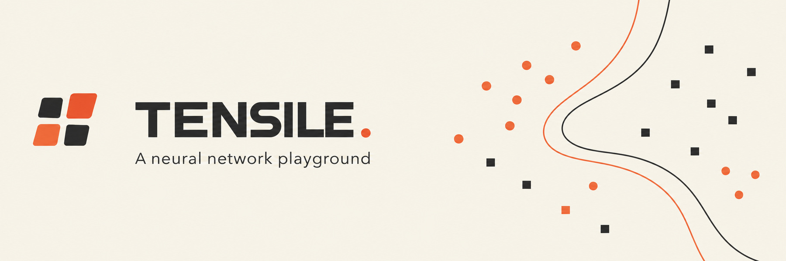

<p align="center">
  
</p>

<p align="center">
  <a href="https://tahaenasraoui-debug.github.io/tensile/">Live Demo</a>
  &nbsp;·&nbsp;
  <a href="https://github.com/tahaenasraoui-debug/tensile">Source Code</a>
</p>

# Tensile — Neural Network Workbench & Autograd Engine

[](https://tahaenasraoui-debug.github.io/tensile/)
[](tests/)

**Tensile** is a clean, readable, and production-grade reverse-mode automatic differentiation engine and deep learning framework built from scratch in **pure NumPy** (Python 3.11+), paired with an interactive **in-browser Computational Graph Inspector & 2D Neural Network Sandbox**.

It provides complete algorithmic transparency into how tensors, DAG reverse-mode autodiff, broadcasting adjoint reduction, neural network layers (Linear, Conv2d, MaxPool2d, LayerNorm, Dropout), optimizers (SGD, Adam, AdamW, RMSprop), and backpropagation work under the hood.

🌐 **Live Interactive Web Sandbox:** **[https://tahaenasraoui-debug.github.io/tensile/](https://tahaenasraoui-debug.github.io/tensile/)**

---

## Key Capabilities

### 1. Interactive In-Browser Sandbox
- **Zero dependencies:** Runs natively in any modern web browser via vanilla JavaScript and HTML5 Canvas.
- **Multiple 2D datasets:** XOR, two moons, concentric circles, and double spiral.
- **Configurable network architecture:** Customizable multi-layer perceptron depth and neuron counts.
- **Rich non-linear activations:** Tanh, ReLU, Sigmoid, and LeakyReLU.
- **Optimizers:** Adam and SGD with momentum, adjustable learning rate, batch size, and regularization.
- **Live visualizations:** Real-time decision surface contour heatmaps, connection weights, and loss curves.

### 2. Pure NumPy Deep Learning & Autograd Engine
- **Reverse-Mode Autodiff:** Dynamic directed acyclic computation graphs (DAG) with topological sorting on `.backward()`.
- **Broadcasting Adjoint Reduction:** Exact multi-dimensional broadcast gradient alignment (`unbroadcast`).
- **Layers & Modules:** `Linear`, `Conv2d`, `MaxPool2d`, `Flatten`, `LayerNorm`, `Dropout`, `ReLU`, `GELU`, `Tanh`, `Sigmoid`, `Softmax`, and `Sequential`.
- **Optimizers:** `SGD` (with momentum), `Adam`, `AdamW` (decoupled weight decay), and `RMSprop`.
- **Model State Dicts:** Clean serialization and deserialization via `state_dict()` and `load_state_dict()`.
- **Losses:** `MSELoss` and numerically stable log-sum-exp `CrossEntropyLoss`.
- **Data Pipeline:** `Dataset`, `TensorDataset`, and batched `DataLoader`.

---

## Project Structure

```text
tensile/
├── index.html                    # Interactive web workbench entrypoint
├── app.js                        # In-browser neural network simulator & visualization logic
├── styles.css                    # Workbench styling and responsive layout
├── assets/                       # Branding images and icons
├── tensile/                      # Core pure-NumPy deep learning engine
│   ├── __init__.py               # Top-level exports
│   ├── tensor.py                 # Core Tensor class, reverse-mode DAG autograd & to_graph_dict()
│   ├── ops.py                    # Functional operator interfaces
│   ├── nn/
│   │   ├── __init__.py           # Neural network module exports
│   │   ├── module.py             # Base Module with train/eval modes and state_dict
│   │   ├── layers.py             # Linear, Conv2d, MaxPool2d, Flatten, LayerNorm, Dropout, activations
│   │   └── losses.py             # MSELoss & stable log-sum-exp CrossEntropyLoss
│   ├── optim/
│   │   ├── __init__.py           # Optimizer exports
│   │   └── optimizer.py          # SGD, Adam, AdamW, and RMSprop optimizers
│   ├── data/
│   │   ├── __init__.py           # Data pipeline exports
│   │   └── dataloader.py         # Dataset, TensorDataset, & DataLoader batching
│   └── utils/
│       ├── __init__.py           # Utility exports
│       └── vis.py                # Graphviz computational graph visualization
├── visualizer/
│   ├── server.py                 # FastAPI backend (/step, /graph) & 2D dataset generator
│   └── web/
│       └── index.html            # Local dashboard UI
├── tests/
│   ├── test_gradcheck.py         # Finite-difference numerical gradient checker (rel error < 1e-5)
│   ├── test_pytorch_parity.py    # Bit-for-bit forward/backward parity checks against PyTorch
│   └── test_cnn_parity.py        # PyTorch parity tests for Conv2d, MaxPool2d, and LayerNorm
├── examples/
│   ├── train_mnist_synthetic.py  # End-to-end 10-class MLP classification benchmark
│   └── train_cnn_mnist.py        # Convolutional neural network digit classification benchmark
├── pyproject.toml                # Project build configuration & dependencies
└── README.md
```

---

## Getting Started

### 1. In-Browser Workbench (No Installation Required)

Simply open `index.html` in your browser, or spin up a quick local web server:

```bash
python -m http.server 8000
```
Then visit `http://localhost:8000`.

### 2. Python Autograd Engine Installation

Clone the repository and set up a virtual environment:

```bash
git clone https://github.com/tahaenasraoui-debug/tensile.git
cd tensile

python -m venv .venv
source .venv/bin/activate
pip install --upgrade pip
pip install -e ".[dev]"
```

---

## Running Verification Tests

### 1. Finite-Difference Numerical Gradient Checks (`< 1e-5` Relative Error)
Verifies analytical `.backward()` gradients against central finite differences:

```bash
pytest tests/test_gradcheck.py -v
```

### 2. PyTorch Parity Verification
Verifies forward activations, cross-entropy loss, analytical gradients, and optimizer updates match `torch`:

```bash
pytest tests/test_pytorch_parity.py -v
```

### 3. Run Entire Test Suite
```bash
PYTHONPATH=. pytest tests/ -v
```

---

## Core Architecture Highlights

- **Reverse-Mode Autograd (`Tensor`):** Tracks dynamic computational graphs via `_prev` / `_parents` pointers and executes Depth-First Search (DFS) topological sorting during `.backward()`.
- **Broadcasting Invariance (`unbroadcast`):** Automatically contracts prepended higher-rank dimensions and sums across singleton broadcast axes (`keepdims=True`) so gradient shapes strictly match operand shapes across elementwise ops and N-D batched `matmul`.
- **Numerically Stable `CrossEntropyLoss`:** Computes categorical cross-entropy directly via the log-sum-exp trick:
  $$\mathcal{L} = \frac{1}{N} \sum_{i=1}^N \left( \log \sum_{j} e^{z_{i, j} - m_i} + m_i - z_{i, y_i} \right)$$
  with exact $\frac{1}{N}(\text{softmax}(Z) - Y)$ backward propagation.
- **DAG Serialization (`to_graph_dict`):** Exports node IDs, operator labels, tensor shapes, forward value summaries (`min`, `max`, L2 `norm`), gradient norms, and reverse topological playback steps directly to JSON.

<p align="center">Built to make the math visible.</p>
