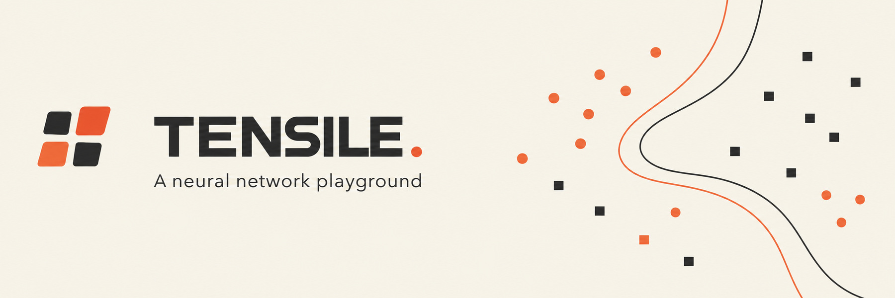

<p align="center">
  
</p>

<p align="center">
  <a href="https://tahaenasraoui-debug.github.io/tensile/">Live demo</a>
  &nbsp;·&nbsp;
  <a href="https://github.com/tahaenasraoui-debug/tensile">Source code</a>
</p>

# Tensile — Neural Network Workbench

Tensile is a small, interactive neural-network playground built to make the mechanics of learning easier to inspect. Change the data, adjust the model, train it in your browser, and watch its decision boundary respond.

No framework, build step, backend, or runtime dependency is required. The model and visualizations run locally in the browser.

## Explore

- **Four datasets:** XOR, two moons, concentric circles, and a double spiral.
- **Model architecture:** adjust the hidden layer from 2 to 16 neurons.
- **Activation functions:** compare Tanh, ReLU, and Sigmoid.
- **Optimization:** switch between Adam and SGD; tune the learning rate and batch size.
- **Live visualizations:** inspect the decision surface, connection weights, and loss trace while the model trains.
- **Training controls:** train continuously, advance one epoch at a time, regenerate data, or reset the weights.

## Run locally

Clone the repository, then open `index.html` in a browser. You can also start a simple local server from the project directory:

```bash
python -m http.server 8000
```

Visit `http://localhost:8000`.

## How the model learns

Tensile uses a compact multilayer perceptron with one hidden layer. Its training loop is implemented in plain JavaScript:

1. **Forward pass** — inputs move through weighted connections and activation functions.
2. **Backpropagation** — the binary cross-entropy loss is differentiated using the chain rule.
3. **Optimization** — Adam or SGD updates the model's weights and biases.

The decision surface is recalculated from the current weights. It is not a prerecorded animation.

> **About the metrics:** loss and accuracy are calculated on the generated training dataset. There is no separate validation or test split, so the displayed accuracy should not be interpreted as a measure of generalization.

## Project structure

```text
.
├── assets/
│   └── tensile-banner.jpg
├── app.js
├── favicon.svg
├── index.html
├── README.md
└── styles.css
```

## Deploy with GitHub Pages

The site is static. In the repository's **Settings → Pages**, choose the branch and folder you want to publish (for example, the repository root), then save. Keep `index.html`, `styles.css`, `app.js`, `favicon.svg`, and the `assets/` folder together so their relative paths continue to work under the `/tensile/` project URL.

---

<p align="center">Built to make the math visible.</p>
